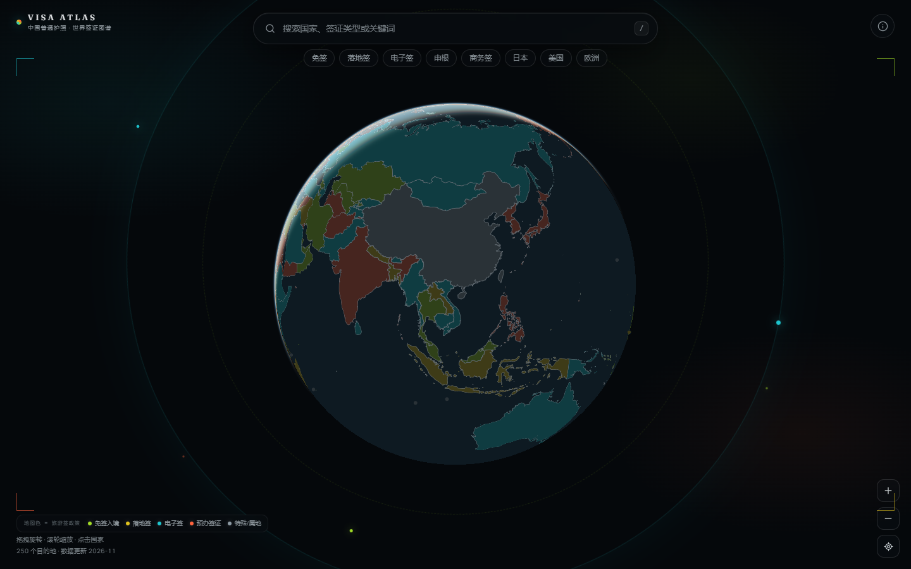
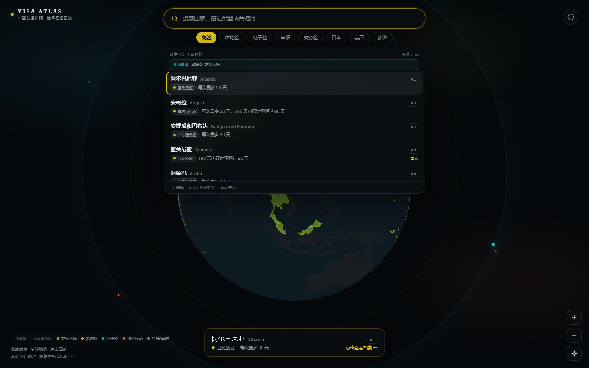
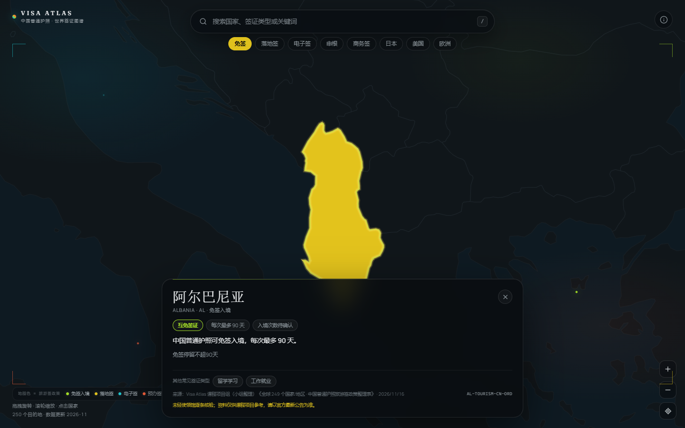
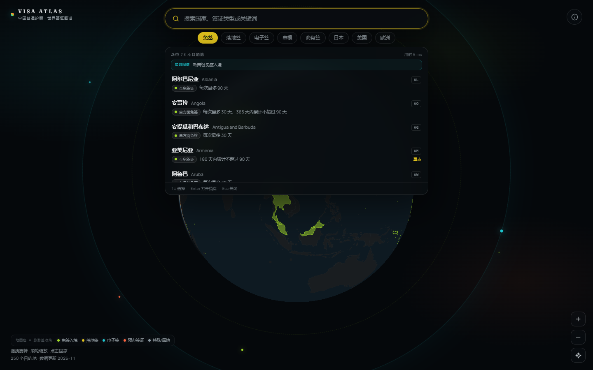
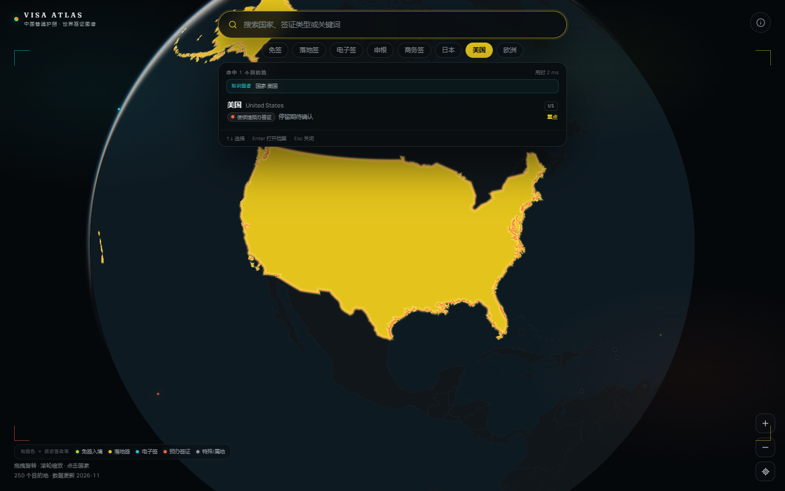
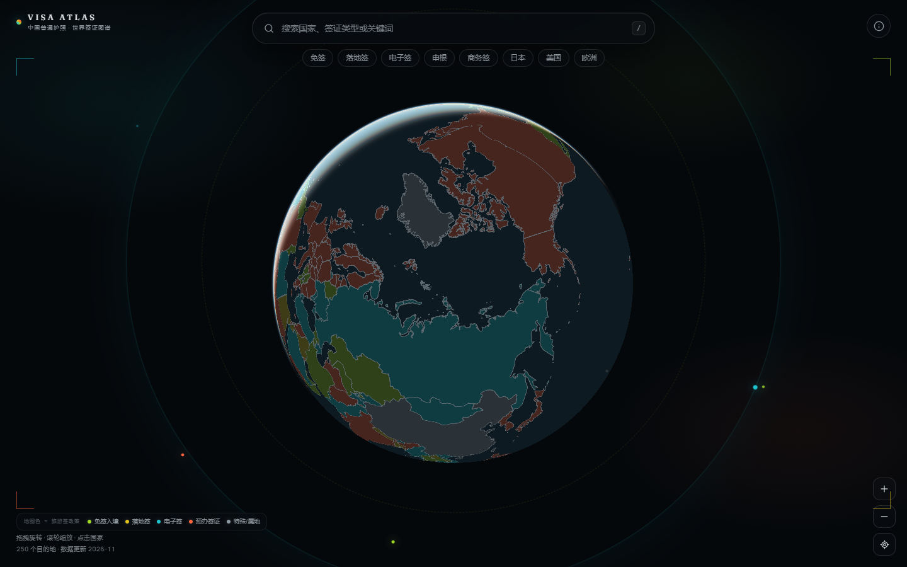

# Visa Atlas · 世界签证图谱

> **中国普通护照出境签证查询与地球探索系统**（课程项目）
> 以小组整理的 **249 个国家/地区旅游签数据** 完成真实落地：可拨动缩放的地球仪 + 预置词/模糊搜索 + 国家签证抽屉。
> 数据为公开信息整理与虚构演示样本，**非官方、不可作为申请依据**。



| 悬停国家 | 国家签证抽屉 | 搜索与预置词 | 知识图谱检索 | 极地视角（环带已移除） |
|---|---|---|---|---|
|  |  |  |  |  |

## 1. 项目定位

| | 内容 |
|---|---|
| 课程主题 | 数据库全栈开发（关系模型、索引、视图、约束、事务、SQLite/MySQL 双模式、后端 API、前端交互） |
| 交互理念 | 一屏只有「一个地球 + 一个搜索框」；筛选、查询、结果、详情全部收进地图与搜索交互，不做筛选面板/卡片墙 |
| 真实数据 | 249 国旅游签摘要（政策分类、停留期、入境次数、类型线索），91 个重点候选目的地 |
| 不在范围 | 手机端、账户体系、后台管理、自动采集、实时更新、获签概率预测 |
| 外部服务依赖 | **无**。地球几何在构建期从 `world-atlas` 生成，运行期不联网、不需要任何地图 Key |

## 2. 快速开始

要求：**Node.js 24+**（使用内置 `node:sqlite`）、npm。

```powershell
npm install
npm run setup     # ETL 数据 → 地球几何 → 初始化并导入 SQLite
npm run dev       # API :3001 + Web :5173
```

打开 <http://127.0.0.1:5173>。首次启动会自动使用 `data/visaatlas.sqlite`；若数据库文件不存在，API 启动时会自动建库并导入 `data/generated/dataset.json`。

生产构建（同源提供页面与 API）：

```powershell
npm run build
npm start          # http://127.0.0.1:3001
```

### MySQL 8（课程数据库路径，可选）

```powershell
Copy-Item .env.mysql.example .env     # 填入本机 MySQL 账号
npm run data:build
npm run db:init:mysql                 # 建表（需 DB_ADMIN_*）
npm run db:seed:mysql                 # 从 data/generated/dataset.json 幂等导入
npm run dev
```

SQLite 与 MySQL 结构同构（见 `database/schema.sql` / `database/schema.mysql.sql`），API 响应完全一致，页脚显示当前模式与数据集版本。

## 3. 已实现功能

### 3.1 可交互地球（MapLibre GL globe）

- 全屏自绘球体：**拖拽旋转、滚轮/双指缩放（0.5–10 倍）、双击放大、右下角 +/−/重置**；初始约屏高 2/3，缩放后可查看大国与小国/岛国。
- 配色分层：**陆地基色 = 旅游签政策组语义色**（免签绿 `#A0DA26`、落地签黄 `#DFC11D`、电子签青 `#1DC5CE`、预办签证珊瑚 `#FF633D`、特殊/属地为中性灰），不再是“只为区分而区分”的五花八门颜色；左下角常驻**政策色图例**说明颜色含义。
- 高亮：**hover = 政策组亮色**；**selected = 参考黄 `#E3C31C` + 政策组内描边/柔光**；**选中国家后其他地区统一进入深灰 focus 静默态**，只保留选中与 hover 对比，不再各自按底色亮起；检索命中按政策组淡彩着色，未命中变暗 `#191d20`。
- **装饰性 HUD**：球体外圈缓慢旋转的轨道线、四角括号、彩色微光点和品牌渐变点，均为纯 CSS/pointer-events:none，不遮挡地图交互。
- 点击国家：地球飞行聚焦（大国有上下文、小国适当放大），国家变黄并打开底部签证抽屉。
- 微国家：14 个无多边形国家以可点击圆点呈现，圆点同样带政策组语义色；hover/选中放大。
- **拖动地球后悬停失效已修复**：在空白/球体外/UI 上松开拖拽都会清空按下状态，不需要再点击一次唤醒悬停。
- **极区修复**：移除原经纬网装饰；对跨 ±180° 的国家多边形做反经线切分（RFC 7946 §3.1.9），避免 MapLibre globe 把跨日界线长边渲染成南北极同心环带，极区国家不再被“假国境线”遮挡。
- 点击空白关闭抽屉并清除选中；`/` 聚焦搜索。

### 3.2 搜索（预置词 + 模糊搜索）

- 顶部玻璃搜索胶囊 + 8 个预置词：`免签` `落地签` `电子签` `申根` `商务签` `日本` `美国` `欧洲`；点击立即筛选，再次点击取消。
- **本地模糊国家建议**：250 国中英文名/ISO/别名，忽略大小写、子串、英文编辑距离 ≤1、中文包含/字序容忍（例如 `Japn` → 日本）。
- **知识图谱优先检索**：后端把国家/地区/政策组/类别/签证类型建成节点，把政策、类型线索、别名与同义词建成边；查询先解析成图谱实体再取精确国家集合：
  - `美国` → 国家节点，**只返回美国**（不再返回摘要中提到美国签证的其他国家）；
  - `欧洲` → 地区节点，返回欧洲国家；`申根` → 申根签证类别；
  - `免签`/`落地签`/`电子签` → 对应政策组；`商务签` → BUSINESS 类型线索；
  - 未命中实体才回退全文检索。
- 300ms 防抖调用后端 `/api/v1/search`：显示「命中 N 个目的地」结果行与**「知识图谱 · 国家·美国」解释**；行内类别徽章带政策组语义色点。
- **搜索结果行 hover 同步高亮地球**：命中国家按语义色显示、未命中变暗；搜索到明确国家时地球自动飞过去。
- ↑↓ 选择、Enter 打开档案、Esc 关闭；结果行 hover 时出现固定悬浮卡，可直接点击打开抽屉。
- 无结果/模糊输入时给出相近国家建议与预置词快捷入口。

### 3.3 国家签证抽屉（Bottom Sheet，精简版）

- 只展示**本轮可规模化采集**的字段：国家中英文名 + **政策组语义色类别 chip** + 停留期 + 入境次数 + 一句话结论 + 原文摘要 + 其他签证类型 chips + 来源/路线编号/免责声明。
- 不再预留费用、材料、审核时间、完整度、演示明细等空位——这些字段属于未来可选扩展，不增加本轮数据收集尺度；未来补采时后端可升级 `data_status`，前端只需按需扩展。
- 类型线索 chips 可点击，切换为该用途（商务/留学/工作…）检索。
- 目录内未采集国家（`XK`）显示明确空态；无资料不伪造。

### 3.4 数据与数据库

- 真实数据：**249 条旅游签政策**（250 国目录中仅 `XK` 未采集）；CSV 原始 76 种分类归一化为 **16 个可筛选类别 / 5 个政策组**；抽取停留期（132/249）、入境次数；**569 条**其他签证类型线索；**351 条**检索同义词。
- **知识图谱**：后端在数据库字典/政策/线索/同义词上构建国家—地区—政策组—类别—签证类型图，`/api/v1/search` 优先走图谱精确解析，并在响应中返回可解释的 `graph` 元数据。
- 演示明细：**22 条**明确虚构（商务/留学/工作等 10 类），只作为未来字段/data_status 的回归夹具保留后端，v4 UI 不展示。
- 数据库：15 张表 + 2 个视图 + 完整外键/CHECK/索引；SQLite（默认，零安装）与 MySQL 8（同构）。
- 数据链路：`CSV → scripts/etl.ts → data/generated/dataset.json → scripts/db-seed.ts → SQLite/MySQL`，可重放、可校验、可 diff。
- 地球几何：`world-atlas` 1:50m → `scripts/build-globe-geo.ts` → `public/geo/*.geo.json`（236 多边形 + 14 微国家点 + 中心/bbox；跨反经线国家在 ±180° 切分；无经纬网），构建期完成，无运行时外部请求。

## 4. 数据与来源

| 项目 | 说明 |
|---|---|
| 真实数据 | `data/source/global_249_countries_cn_passport_visa.csv`（小组整理，249 行） |
| 来源等级 | `SINGLE_SOURCE`：小组汇总，无逐国官方链接；界面与文档持续提示以官方公告为准 |
| 当前成熟度 | `SUMMARY_ONLY`：政策类别 + 一句摘要 + 抽取的停留期；界面只展示可规模化采集的字段（费用/材料/审核时间不预留空位） |
| 未采集国家 | `XK`（目录保留，抽屉显示「尚未纳入本轮采集」） |
| 演示数据 | `data/source/demo-details.json`（22 条，完全虚构，`is_demo=1`） |
| 同义词 | `data/source/synonyms.json`（351 条，检索辅助，不含政策事实） |
| 地图数据 | `world-atlas@2`（Natural Earth 1:50m，公共领域）；国家目录来自 `world-countries`（ODbL-1.0，见 `data/ATTRIBUTION.md`） |
| 质量报告 | `data/generated/report.md`（分类分布、停留期解析、未识别类型词、名称差异） |

重新生成与校验：

```powershell
npm run data:build     # CSV + 演示 + 同义词 → dataset.json / report.json / report.md
npm run data:check     # 结构、枚举、外键引用、数量与边界校验
npm run geo:build      # world-atlas 50m → public/geo/{countries,microstates}.geo.json（±180° 切分，无经纬网）
npm run db:rebuild     # 重建 SQLite 并幂等导入
```

## 5. 数据库设计一览

```
regions ─< countries ─< visa_policies >─ visa_types
                │             ├─< policy_documents
                │             ├─< policy_fees
                │             ├─< policy_timings
                │             ├─< policy_rules
                │             └─> data_sources / data_batches
                └─< mentioned_visa_types >─ visa_types
policy_groups ─< visa_categories ─< visa_policies
search_synonyms / app_meta
```

- 关键视图：`v_country_map`（地球着色与统计）、`v_policy_cards`（卡片字段统一）。
- 关键约束：`route_code` 稳定主键；`is_demo`/`data_status` 隔离演示与摘要；`completeness` 0–100；`stay_rule` 支持滚动窗口；金额/币种成对。
- 完整字段、索引与扩展规则见 [docs/DATA-DICTIONARY.md](docs/DATA-DICTIONARY.md)。

## 6. API

| 方法 | 路径 | 说明 |
|---|---|---|
| GET | `/api/health` | 存活、数据库模式、数据集版本 |
| GET | `/api/v1/overview` | 元信息 + 统计 + 地图着色 + 字典（首屏一次） |
| GET | `/api/v1/search` | 关键词 + 地区/政策组/类别/用途/停留期/资料状态/重点候选/演示 + 分面 + 分页 + 排序；**知识图谱优先解析**，响应含 `graph` 命中解释 |
| GET | `/api/v1/suggest?q=` | 搜索联想（后端保留；v4 前端优先本地模糊） |
| GET | `/api/v1/countries/:iso2?demo=1` | 国家档案（真实政策、类型线索、演示明细、来源） |
| GET | `/api/v1/route/:routeCode` | 单条路线（深链） |

约定：`{data}` / `{error:{code,message,details?}}`；参数校验、参数化 SQL、`no-store`、速率限制（240 次/分钟）。详见 [docs/API.md](docs/API.md)。

## 7. 测试与验收

```powershell
npm test             # 86 tests / 84 pass / 0 fail / 2 skip（MySQL 连接类用例未配置环境时跳过）
npm run test:mysql   # 需要可用 MySQL（读取 .env 或环境变量），5/5 pass
npm run e2e          # Playwright + 系统 Chrome 浏览器验收（需先 npm run dev）
npm run screenshots  # 生成 docs/screenshots 截图
```

浏览器验收覆盖：地球渲染/极地视角、悬停国家、预置词、模糊搜索、搜索结果选择、精简国家抽屉字段、点击地球选国、数据说明弹层、控制台无报错。完整证据见 [docs/VERIFICATION.md](docs/VERIFICATION.md)，前后端代码实现摘录见 [docs/IMPLEMENTATION-REPORT.md](docs/IMPLEMENTATION-REPORT.md)。

## 8. 项目结构

```
client/                 React 19 前端（极简 v4）
  features/map/         MapLibre GL globe（政策组语义色/hover/参考黄选中/focus静默/反经线切分）
  features/search/      搜索胶囊、预置词、本地模糊匹配、结果下拉
  features/details/     国家签证抽屉（精简版，仅可规模化采集字段）
  components/           ⓘ 数据说明弹层、className 工具
  styles.css            v4 设计系统（深黑 + 政策组语义色 + 装饰 HUD）
server/                 Fastify API（SQLite / MySQL 仓储、服务层、路由）
shared/                 前后端共享类型 + ETL 产物类型
database/               SQLite / MySQL 建表 SQL
scripts/                etl.ts · check-data.ts · build-globe-geo.ts · db-*.ts
data/                   source（原始数据）· generated（ETL 产物）· geo（几何报告）
public/geo/             运行期地球 GeoJSON（Vite 构建自动复制到 dist）
tests/                  node:test + Playwright 验收
docs/                   架构、审计、设计规范、API、数据字典、验收；legacy-base 为旧版归档
```

## 9. 扩展方式（未来采集到更多数据时）

1. 把新批次放进 `data/source/`，在 `scripts/etl.ts` 中合并（字段格式见 `shared/dataset.ts`）。
2. 真实明细的 `data_status` 从 `SUMMARY_ONLY` 升为 `PARTIAL/DETAILED`，填写 `documents/fees/timings/rules` 与真实 `source_id`。
3. 运行 `npm run data:build && npm run data:check && npm run db:seed`（MySQL 用 `db:seed:mysql`）。
4. 前端地球、搜索、抽屉会自动使用新类型/新字段，无需改 UI 代码。

`data/source/README.md` 说明了数据来源、字段含义与演示数据边界。

## 10. 已知限制与免责声明

- 本轮真实数据为**摘要级**：没有逐国官方 URL、费用、材料、审核时间与完整个人条件规则；v4 界面只展示可规模化采集的字段，不再预留这些空位。
- 政策分类归一化存在解释空间；复合路线（如「落地签/电子签」）按来源顺序归入主类别，次选方式保留原文。
- 停留期由中文文本规则抽取（132/249 条可解析），可能与最新政策有出入。
- 演示明细为完全虚构样本，仅保留在后端作为未来字段回归夹具，界面不展示，不可用于申请。
- 地球为 MapLibre GL JS 球体投影，无卫星/街道底图；14 个微国家以圆点呈现（Natural Earth 1:50m 本身无多边形）；跨 ±180° 多边形已切分，极区不再出现假环带。
- 仅面向桌面 Web（≥1180px）。

> 本项目的签证信息来自公开资料整理与虚构演示样本，未经使领馆逐条确认，不构成签证、法律或出行建议。请以中国领事服务网与目的地使领馆最新公告为准。

## 11. 文档索引

- [docs/AUDIT-BASE.md](docs/AUDIT-BASE.md)：对 base v0.1 的审计与本轮修订决策
- [docs/VERIFICATION.md](docs/VERIFICATION.md)：测试、构建、浏览器与 MySQL 验收记录
- [docs/ARCHITECTURE.md](docs/ARCHITECTURE.md)：系统架构、数据链路、扩展点
- [docs/API.md](docs/API.md)：接口约定与检索语义
- [docs/DATA-DICTIONARY.md](docs/DATA-DICTIONARY.md)：数据库字段、视图、索引、成熟度
- [docs/DESIGN-SYSTEM-V2.md](docs/DESIGN-SYSTEM-V2.md)：极简地球界面视觉与交互规范（v4 内容）
- [docs/IMPLEMENTATION-REPORT.md](docs/IMPLEMENTATION-REPORT.md)：前后端技术栈与架构分工说明（语言/框架/数据流）
- [data/geo/REPORT.md](data/geo/REPORT.md)：地球几何覆盖与生成说明
- [data/generated/report.md](data/generated/report.md)：ETL 数据质量报告
